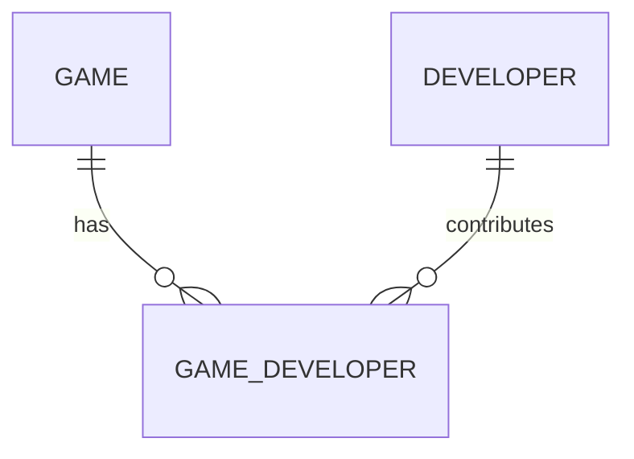

# Database design baseline

## Design status

The agreed **15 MySQL tables are frozen**. This is a transcription of the supplied generated ER diagram plus an explicit clarification of its developer junction. It is a logical baseline, not executable DDL or a fully specified physical schema. Exact types, lengths, nullability, defaults, checks, indexes, and referential actions must be documented when DDL is written; do not silently treat suggestions below as approved changes.

Sources: [generated diagram](reference/ERdiag-gen.jpeg) and [handwritten reference](reference/writeen-ERdiag.jpeg). The generated diagram's line labels and junction connections are visually ambiguous in places; the following junction interpretation makes the intended relationships explicit without adding tables.

## Tables and diagram attributes

Composite keys below are the pairs underlined in the generated diagram. `PK` means primary key; `FK` means foreign key. Non-key attributes are listed as shown, without assigning new SQL types.

| # | Table | Primary key | Foreign keys | Other attributes |
| --- | --- | --- | --- | --- |
| 1 | GAME | game_id | publisher_id -> PUBLISHER.publisher_id | rawg_id, steam_app_id, title, description, release_date, age_rating, metacritic_score, base_price, created_at |
| 2 | PUBLISHER | publisher_id | None | name, country, website |
| 3 | DEVELOPER | developer_id | None | name, country, website |
| 4 | GAME_DEVELOPER | (game_id, developer_id) | game_id -> GAME.game_id; developer_id -> DEVELOPER.developer_id | role |
| 5 | GENRE | genre_id | None | name, description |
| 6 | GAME_GENRE | (game_id, genre_id) | game_id -> GAME.game_id; genre_id -> GENRE.genre_id | None |
| 7 | TAG | tag_id | None | name, description |
| 8 | GAME_TAG | (game_id, tag_id) | game_id -> GAME.game_id; tag_id -> TAG.tag_id | None |
| 9 | PLATFORM | platform_id | None | name, manufacturer |
| 10 | GAME_PLATFORM | (game_id, platform_id) | game_id -> GAME.game_id; platform_id -> PLATFORM.platform_id | None |
| 11 | USER | user_id | None | name, email, password_hash, role, created_at |
| 12 | WISHLIST | wishlist_id | user_id -> USER.user_id | name, created_at |
| 13 | WISHLIST_GAME | (wishlist_id, game_id) | wishlist_id -> WISHLIST.wishlist_id; game_id -> GAME.game_id | target_price, priority, added_at |
| 14 | STORE | store_id | None | name, country |
| 15 | PRICE_HISTORY | price_id | game_id -> GAME.game_id; store_id -> STORE.store_id | price, currency, discount_percentage, recorded_at |

## GAME and DEVELOPER: many-to-many

Each `GAME_DEVELOPER` row belongs to exactly one GAME and exactly one DEVELOPER. A game may have multiple developers, and a developer may contribute to multiple games. Join through `GAME_DEVELOPER`; do not add a single `developer_id` column to GAME or a direct developer foreign key to `GAME.title`.

The composite primary key `(game_id, developer_id)` prevents duplicate game/developer pairs. The `role` attribute describes that developer's contribution to that game. With this existing key, one pair has one stored role value; multiple rows per pair would require a reviewed design change rather than silently expanding the key.

## Other relationships

- PUBLISHER 1:N GAME through `GAME.publisher_id`.
- GAME M:N GENRE through GAME_GENRE.
- GAME M:N TAG through GAME_TAG.
- GAME M:N PLATFORM through GAME_PLATFORM.
- USER 1:N WISHLIST through `WISHLIST.user_id`.
- WISHLIST M:N GAME through WISHLIST_GAME; target price and priority belong to the wishlist membership.
- GAME 1:N PRICE_HISTORY and STORE 1:N PRICE_HISTORY. Each observation belongs to one game and store and records a timestamp and currency.

Whether a parent must have at least one child, and whether an FK may be NULL, still needs explicit DDL decisions. The developer diagram above uses zero-or-more child rows as a conservative baseline, not a new participation requirement.

## Integrity decisions to resolve during DDL

Keep the table set and agreed attributes. Review these details before implementation:

- Use exact decimal types for monetary amounts; establish a consistent currency for `GAME.base_price` and `WISHLIST_GAME.target_price`, which have no currency column in the diagram. Do not compare mixed currencies without an agreed policy.
- Choose the timestamp convention and precision for price observations and audit fields.
- Specify nonnegative price checks, discount bounds, allowed roles/priorities, and meaningful score bounds.
- Define email uniqueness and normalization, password-hash storage, FK indexes and deliberate delete/update behavior.
- Decide how nullable external IDs (`rawg_id`, `steam_app_id`) and their uniqueness should behave.
- Define duplicate-ingestion behavior for price observations. Do not invent an extra table to solve it without review.
- Review SQL identifier quoting, especially `USER`, consistently in DDL and queries.

These are unresolved implementation details or identified questions, not implemented guarantees.

## MongoDB review model (planned)

Use a review collection keyed by a stable review/provider identity and an internal MySQL `game_id`. Proposed content includes provider, provider review ID, text, language, recommendation/rating, review timestamps, provider-specific metadata, and optional sentiment result plus method/version. Exact field names and validation are pending.

Plan indexes for game/time retrieval and review deduplication, and an aggregation that groups sentiment by game/time. Document source provenance, missing-field handling, and how review summaries relate to price dates. MongoDB references cannot enforce MySQL foreign keys: server code must validate identity and define cleanup/reconciliation behavior.

## Qdrant model (planned)

Use one documented game embedding representation derived from agreed catalog text (for example title, description, genres and tags). Each point must map back to `game_id`; useful payload may include filter metadata and model/version. Model, dimensionality, metric, point-ID mapping, chunking, and collection naming are still pending.

Document how text is embedded, how queries use the same model, filtering/ranking behavior, updates when game data changes, and retrieval evaluation. Qdrant results should be hydrated from MySQL and checked for stale IDs. Cross-store updates need explicit retries/reconciliation; no atomic transaction across all three databases is assumed.
